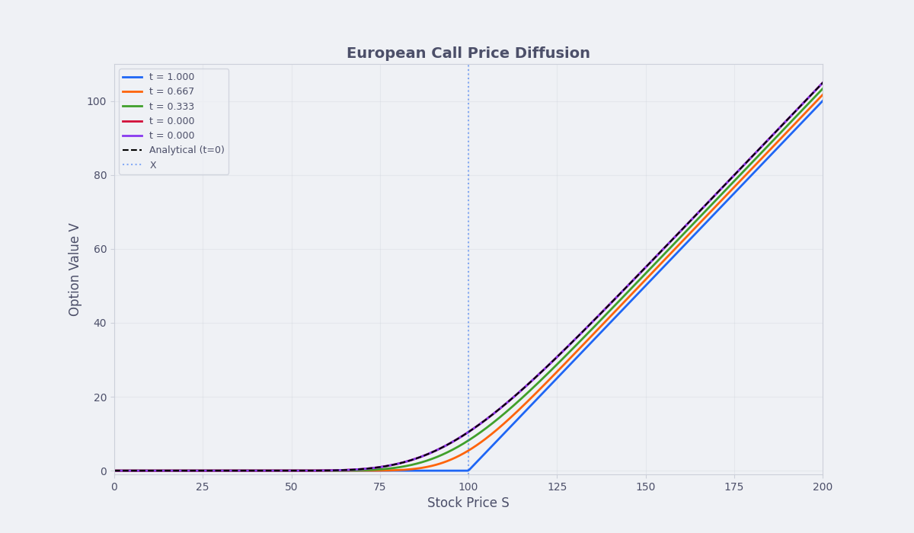
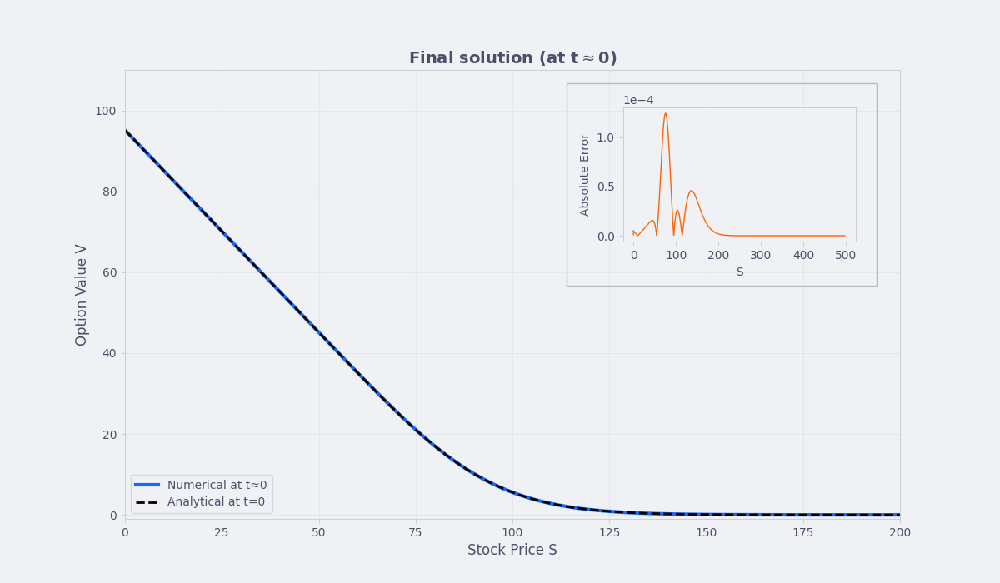
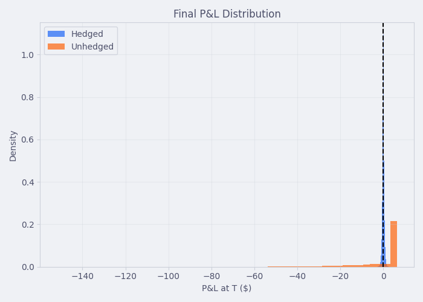
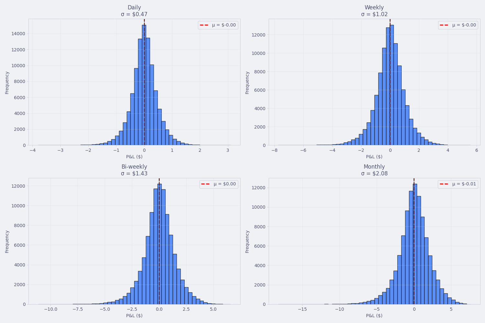
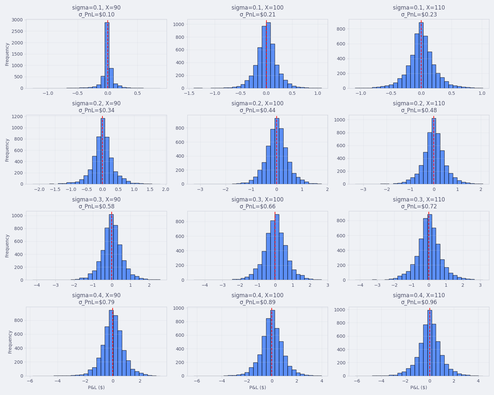
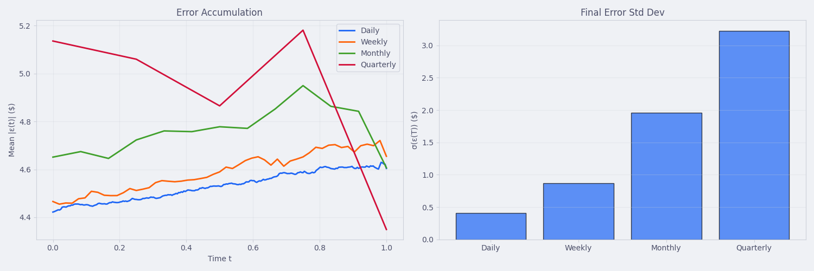

# delta_hedging_simulation
A Python simulation made to serve as a final project for Numerical Methods in Finance course at the Jagiellonian University in Krakow. It is a Jupyter notebook showcasing methods for simulating stock prices, solving the Black-Scholes PDE for options and analysing the delta hedging strategy on a simulated portfolio.

### View the notebook
See the fully evaluated HTML version of the notebook in `Delta_hedging.html`.  
For the option to modify and run the notebook's contents, clone this repository and run
```bash
pip install -r requirements.txt
jupyter notebook Delta_hedging.ipynb
```

## Sample results
Call option value diffussion  

  

Put option final value from numerical calculation vs analytical  


Hedged vs unhedged P&L distribution  


Hedging results for different rebalancing frequencies  


Hedging results for different market conditions  


Error accumulation for different frequencies  


### Acknowledgements
Parts of the project made in collaboration with Arnold Voicinovič [[GitHub](https://github.com/arni-v)]
